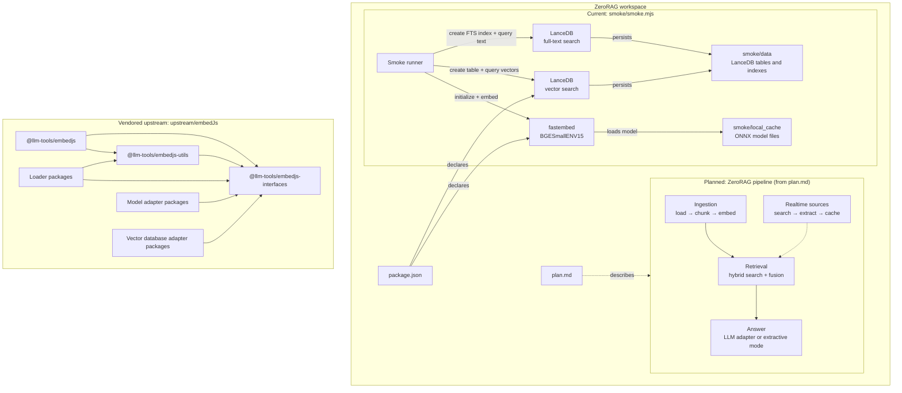

# Workspace graph

This graph separates the current executable smoke test, the vendored upstream
monorepo, and the intended ZeroRAG design. Solid arrows describe current
dependencies or runtime flow; dashed arrows are planned and are not implemented
in this workspace yet.

## Evidence and boundaries

- The smoke runner is [smoke/smoke.mjs](./smoke/smoke.mjs); it embeds three
  sample strings, creates a LanceDB table, runs vector search, then attempts
  full-text search.
- The runtime model cache and LanceDB data are generated under
  `smoke/local_cache/` and `smoke/data/`; these are runtime artifacts, not
  source modules.
- Root dependencies are declared in [package.json](./package.json).
- The upstream workspace boundaries are declared in
  [upstream/embedJs/package.json](./upstream/embedJs/package.json). Its core
  dependency edges are corroborated by the package manifests under
  `upstream/embedJs/core/`, `upstream/embedJs/loaders/`,
  `upstream/embedJs/models/`, and `upstream/embedJs/databases/`.
- The dashed target pipeline is design intent from [plan.md](./plan.md), not
  working ZeroRAG implementation. In particular, realtime search, hybrid
  retrieval, and answer generation are not in the current smoke runner.
